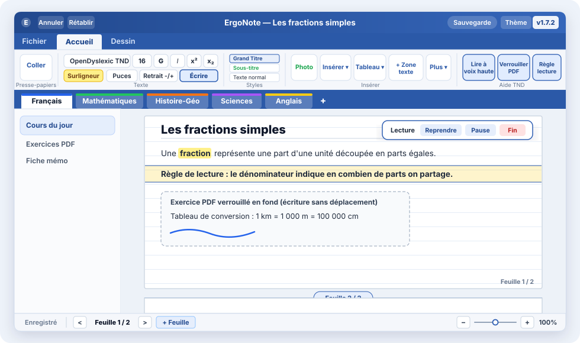

# ErgoNote

### Cahier numérique scolaire conçu pour les élèves présentant un TND
*(Troubles du Neurodéveloppement : DYS, TDAH, troubles du graphisme et des apprentissages)*

[-0078D6?style=for-the-badge&logo=windows&logoColor=white)](https://github.com/Masterz42/ErgoNote/releases/latest)

[-3DDC84?style=for-the-badge&logo=android&logoColor=white)](https://github.com/Masterz42/ErgoNote/releases/latest)

 

  

**[Télécharger ErgoNote v1.4 pour Windows (.exe)](https://github.com/Masterz42/ErgoNote/releases/latest/download/ErgoNote-v1.4-Windows-x86_64.exe)** · **[Télécharger ErgoNote v1.4 pour Android (.apk)](https://github.com/Masterz42/ErgoNote/releases/latest/download/ErgoNote-v1.4-Android.apk)** · **[Télécharger ErgoNote v1.4 pour Linux](https://github.com/Masterz42/ErgoNote/releases/latest/download/ErgoNote-v1.4-Linux-x86_64)** · **[Toutes les versions](https://github.com/Masterz42/ErgoNote/releases)**

---

## Pourquoi ErgoNote ?

Les logiciels de prise de notes classiques sont souvent **surchargés d'icônes**, découpent les pages en zones flottantes imprévisibles et affichent du vocabulaire technique déroutant pour un élève.

**ErgoNote** a été pensé pour offrir en classe comme à la maison un **classeur numérique apaisé, prévisible et autonome** :

- **Visuel immédiat** : onglets matières colorés en haut (comme de vrais intercalaires : *Français, Maths, Histoire-Géo…*).
- **Ruban ultra-simplifié** : seulement **3 onglets** (`Accueil`, `Dessin`, `Affichage`), zéro doublon.
- **Vraies feuilles A4 entières** : plus de coupure en milieu de page — une 2ᵉ feuille apparaît automatiquement dès que le contenu dépasse, avec un compteur `< Feuille 1 / 2 >` en bas.
- **100 % autonome & local** : aucun compte en ligne, sauvegarde complète en un clic (`.zip`), formats standards lisibles partout.

---

## Adaptations TND intégrées

| Outil | Bénéfice concret pour l'élève |
|---|---|
| **Onglets matières colorés** | Repérage visuel immédiat des matières sous le ruban, sans se perdre dans une arborescence complexe. |
| **Feuilles A4 entières & pagination** | L'élève écrit du haut jusqu'en bas sur une vraie feuille A4 ; ajout automatique d'une feuille suivante + navigation `< Feuille X / Y >` et bouton `+ Feuille`. |
| **Verrouillage PDF / Images** | Fige la fiche d'exercice en fond pour écrire au clavier ou tracer au stylet par-dessus sans jamais la déplacer par erreur. |
| **Lecture à voix haute + barre directe** | Synthèse vocale française naturelle avec barre flottante **Lire / Pause / Fin** dès le lancement pour relire consignes et textes. |
| **Règle de lecture visuelle** | Bande colorée horizontale suivant le pointeur pour limiter les sauts de ligne lors de la lecture. |
| **Police OpenDyslexic TND** | Intégrée nativement sur tous les systèmes (Linux, Windows, Android, Web/iPad). |
| **Gabarits scolaires en 1 clic** | Tableaux de conversion (`km → mm`), numération (`Mille / Unités / Décimales`), proportionnalité, boutons `x²` / `x₂` et retrait `-/+`. |
| **Palette 16 couleurs (dont vrai jaune vif)** | Surlignage lisible et contrasté adapté aux codes couleurs scolaires (consignes, mots-clés, leçons). |
| **Bouton « Écrire » sur tablette** | Permet de revenir instantanément du mode stylet/dessin à la saisie clavier. |

---

## Compatibilité multi-supports

| Plateforme | Usage |
|---|---|
| **Windows (`x86_64`)** | Exécutable autonome `ErgoNote-v1.4-Windows-x86_64.exe` pour PC portables scolaires |
| **Linux (`x86_64`)** | Binaire natif `ErgoNote-v1.4-Linux-x86_64` |
| **Android (Smartphone & Tablette)** | APK `ErgoNote-v1.4-Android.apk` : interface adaptative téléphone/tablette, boutons directs *Photo* et *Image*, saisie Gboard avec correcteur, stylet et touche *Écrire* |
| **iPad / Navigateur** | Version WebAssembly utilisable hors ligne |

---

## Historique des modifications (depuis la v1.0)

### `v1.4` — Gras/Italique fiabilisé, touche Entrée corrigée & expérience mobile Android
- **Mise en forme Gras / Italique et touche Entrée fiabilisées** : coupure propre des lignes sur Entrée sans étoiles résiduelles (`**`) ni blocage, placement sécurisé du curseur hors des balises de formatage et vraie police grasse intégrée (`LiberationSans-Bold`).
- **Mode adaptatif Smartphone & Tablette Android** : ruban mobile compact sans défilement horizontal (sur 2 lignes si besoin) et accès complet aux options via le tiroir latéral.
- **Saisie clavier Gboard & correcteur orthographique** : pont IME Android natif gérant la correction orthographique, le gras/italique en cours de frappe et le retour à la ligne sans artefacts.
- **Boutons dédiés Photo & Image sur Android** : insertion directe depuis la galerie (*Image*) ou prise de photo du tableau / d'une fiche (*Photo*).
- **Barre d'état mobile sans chevauchement** : compteur `< Feuille X / Y > + Feuille` ancré à droite et message d'enregistrement tronqué proprement à gauche.
- **Stabilité Android renforcée** : démarrage, reprise après mise en arrière-plan et geste *Retour prédictif* fiabilisés.

### `v1.3` — Feuilles A4 entières, pagination & identité ErgoNote
- **Correction du blocage en milieu de page** : suppression de la limite verticale qui coupait l'écriture à mi-feuille ; clic possible partout dans la feuille pour continuer à écrire.
- **Vraies feuilles A4 entières + 2ᵉ feuille automatique** : ajout automatique de feuilles dès que le cours ou un PDF dépasse le bas de la page, avec séparateur visuel `Feuille 2 / 2`.
- **Compteur et navigation en bas d'écran** : `< Feuille X / Y >` + bouton `+ Feuille`.
- **Barre du bas épurée** : suppression des mentions techniques (`CommonMark + GFM`, `HTML`, chemin des fichiers) qui perturbaient les élèves.
- **Nouvelle identité `ErgoNote`** : remplacement complet de l'ancien nom dans l'interface, la barre de titre et la fenêtre *À propos*.

### `v1.2` — Ruban ultra-simplifié & ergonomie tactile
- **Fusion des onglets *Accueil* et *Insérer*** : le ruban passe de 4 onglets à **3 onglets** (`Accueil`, `Dessin`, `Affichage`).
- **Suppression de tous les doublons** : retrait de *Stylet/Clavier*, *Fiche PDF*, *Photo tableau*, *Recentrer*, *Couleur feuille*, *Texte aéré TND*, *Fichier Impression / Pièce jointe*, et simplification de *Sélectionner / Lasso* dans *Dessin*.
- **Onglet *Insérer* clarifié** : *Capture d'écran* remplacé par **Photo**, *Images* remplacé par un menu unifié **Insérer** (*Photo/Image*, *Document PDF*, *Autre fichier*) + menu **Plus** pour les éléments secondaires (*Date*, *Équation*, *Symbole*, *Modèles*).
- **Onglet *Affichage* nettoyé** : bouton unique bascule **Plein écran**, suppression des doublons *Règle de lecture* et *Thème* (déjà toujours visible en haut à droite).
- **Barre flottante de lecture à voix haute** : boutons directs **Reprendre / Pause / Fin** dès le clic sur *Lire à voix haute*.
- **Confort tablette Android** : conservation automatique du mode écriture au doigt et ajout du bouton direct **Écrire** dans *Accueil*.

### `v1.1` — Pack complet d'adaptations TND
- **Terminologie TND** : mise à jour complète de la nomenclature (*Trouble du Neurodéveloppement*).
- **Verrouillage PDF / Images en fond** : bouton dédié dans le ruban et au clic droit.
- **Police OpenDyslexic TND** embarquée sur toutes les plateformes.
- **Règle de lecture visuelle** horizontale suivant le curseur.
- **Synthèse vocale française** (*Lire à voix haute* sur la sélection ou toute la page).
- **Outils mathématiques & mise en forme** : boutons directs exposant `x²`, indice `x₂` et `Retrait -/+`.
- **Gabarits scolaires en 1 clic** : tableaux de conversion, numération et proportionnalité.
- **Badge de version cliquable** en haut à droite ouvrant la liste des nouveautés.

### `v1.0` — Socle classeur scolaire élève
- **Onglets matières horizontaux colorés** façon classeur à intercalaires.
- **Palette 16 couleurs** incluant un vrai jaune fluo scolaire.
- **Sauvegarde et restauration complète en `.zip`** et support multiplateforme (Linux, Windows, Android, WebAssembly).

---

Développé avec soin par <strong>ErgoLib</strong> pour l'accompagnement des élèves TND.

