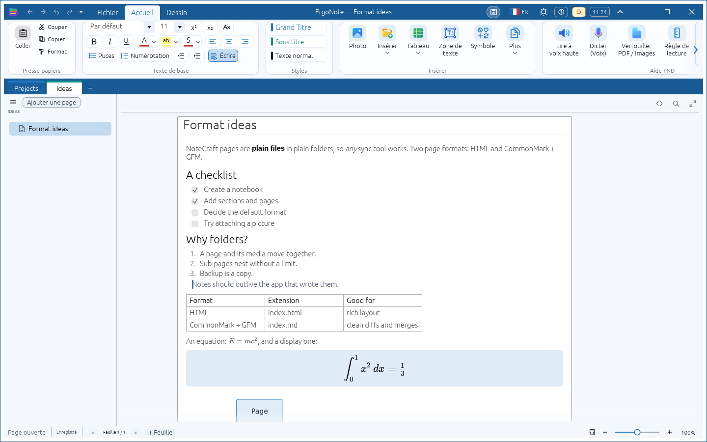
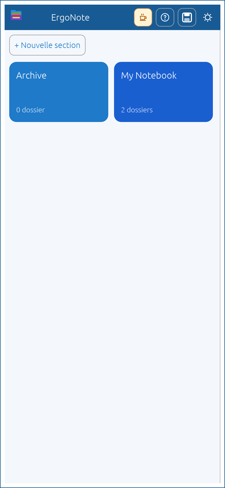
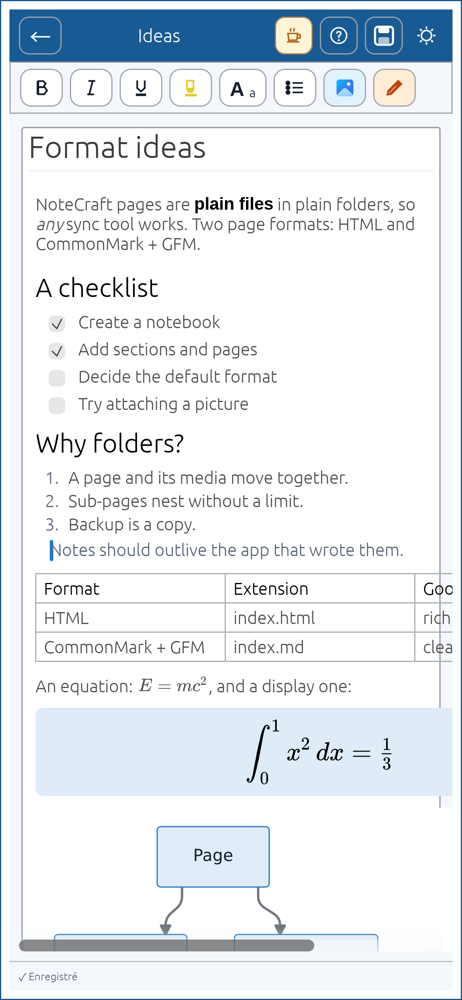
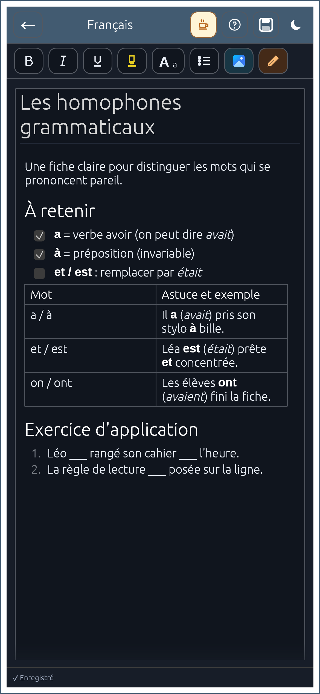

# ErgoNote

**Cahier numérique scolaire adapté aux élèves TND**  
*(DYS, TDAH, troubles du graphisme et des apprentissages - 100 % gratuit, hors ligne et sans pub)*

[Site de présentation](https://masterz42.github.io/ErgoNote/) · [Signaler un bug / Donner un avis](https://masterz42.github.io/ErgoNote/retours.html) · ☕ [Offrir un café (Ko-fi)](https://ko-fi.com/ergonote)

---

## Aperçu en images (`v2026.11.26`)

  
   
  <b>Ordinateur</b> : barre unique, ruban épuré, onglets matières colorés et feuille A4 complète.

 

<table align="center">
  <tr>
    <td align="center"></td>
    <td align="center"></td>
    <td align="center"></td>
  </tr>
  <tr>
    <td align="center"><b>Smartphone</b> : accueil par matières</td>
    <td align="center"><b>Smartphone</b> : fiche de cours</td>
    <td align="center"><b>Smartphone</b> : thème sombre</td>
  </tr>
</table>

---

## Téléchargement (`v2026.11.26`)

| Plateforme | Téléchargement direct | Notes |
|---|---|---|
| **Windows (`x86_64`)** | [ErgoNote-v2026.11.26-Windows-x86_64.exe](https://github.com/Masterz42/ErgoNote/releases/latest/download/ErgoNote-v2026.11.26-Windows-x86_64.exe) | Exécutable autonome pour PC scolaire |
| **macOS (`Apple Silicon`)** | [ErgoNote-v2026.11.26-macOS-arm64.dmg](https://github.com/Masterz42/ErgoNote/releases/latest/download/ErgoNote-v2026.11.26-macOS-arm64.dmg) | Glisser dans Applications · 1er lancement : clic droit → *Ouvrir* |
| **Android (Smartphone & Tablette)** | [ErgoNote-v2026.11.26-Android.apk](https://github.com/Masterz42/ErgoNote/releases/latest/download/ErgoNote-v2026.11.26-Android.apk) | Signé `v1+v2+v3` + Scanner ML Kit + OCR embarqué |
| **Linux (`x86_64`)** | [Paquet `.deb`](https://github.com/Masterz42/ErgoNote/releases/latest/download/ergonote_2026.11.26_amd64.deb) · [Archive `.tar.gz`](https://github.com/Masterz42/ErgoNote/releases/latest/download/ErgoNote-v2026.11.26-Linux-x86_64.tar.gz) · [Binaire natif](https://github.com/Masterz42/ErgoNote/releases/latest/download/ErgoNote-v2026.11.26-Linux-x86_64) | Paquet Ubuntu/Debian, portable ou exécutable direct |

<b>Versions précédentes (3 dernières conservées : v2026.11.25, v2026.11.24, v1.7.2)</b>

 

ErgoNote conserve les **3 versions précédentes** en téléchargement direct pour pouvoir revenir en arrière à tout moment (vos classeurs locaux restent compatibles) :

| Version | Date | Windows (`x86_64`) | Linux (`x86_64`) | Android (`.apk`) | Notes |
|---|---|---|---|---|---|
| **`v2026.11.25`** | 25/11/2026 | [Windows .exe](https://github.com/Masterz42/ErgoNote/releases/download/v2026.11.25/ErgoNote-v2026.11.25-Windows-x86_64.exe) | [.deb](https://github.com/Masterz42/ErgoNote/releases/download/v2026.11.25/ergonote_2026.11.25_amd64.deb) · [.tar.gz](https://github.com/Masterz42/ErgoNote/releases/download/v2026.11.25/ErgoNote-v2026.11.25-Linux-x86_64.tar.gz) · [binaire](https://github.com/Masterz42/ErgoNote/releases/download/v2026.11.25/ErgoNote-v2026.11.25-Linux-x86_64) | [Android .apk](https://github.com/Masterz42/ErgoNote/releases/download/v2026.11.25/ErgoNote-v2026.11.25-Android.apk) | [v2026.11.25](https://github.com/Masterz42/ErgoNote/releases/tag/v2026.11.25) |
| **`v2026.11.24`** | 24/11/2026 | [Windows .exe](https://github.com/Masterz42/ErgoNote/releases/download/v2026.11.24/ErgoNote-v2026.11.24-Windows-x86_64.exe) | [.deb](https://github.com/Masterz42/ErgoNote/releases/download/v2026.11.24/ergonote_2026.11.24_amd64.deb) · [.tar.gz](https://github.com/Masterz42/ErgoNote/releases/download/v2026.11.24/ErgoNote-v2026.11.24-Linux-x86_64.tar.gz) · [binaire](https://github.com/Masterz42/ErgoNote/releases/download/v2026.11.24/ErgoNote-v2026.11.24-Linux-x86_64) | [Android .apk](https://github.com/Masterz42/ErgoNote/releases/download/v2026.11.24/ErgoNote-v2026.11.24-Android.apk) | [v2026.11.24](https://github.com/Masterz42/ErgoNote/releases/tag/v2026.11.24) |
| **`v1.7.2`** | 23/11/2026 | [Windows .exe](https://github.com/Masterz42/ErgoNote/releases/download/v1.7.2/ErgoNote-v1.7.2-Windows-x86_64.exe) | [.deb](https://github.com/Masterz42/ErgoNote/releases/download/v1.7.2/ergonote_1.7.2_amd64.deb) · [.tar.gz](https://github.com/Masterz42/ErgoNote/releases/download/v1.7.2/ErgoNote-v1.7.2-Linux-x86_64.tar.gz) · [binaire](https://github.com/Masterz42/ErgoNote/releases/download/v1.7.2/ErgoNote-v1.7.2-Linux-x86_64) | [Android .apk](https://github.com/Masterz42/ErgoNote/releases/download/v1.7.2/ErgoNote-v1.7.2-Android.apk) | [v1.7.2](https://github.com/Masterz42/ErgoNote/releases/tag/v1.7.2) |

> **Astuce Android / Tablette Lenovo** : autorisez *Installer des applis inconnues* pour votre navigateur ou gestionnaire de fichiers ; si *Google Play Protect* affiche un avertissement « Appli non reconnue », touchez **Plus de détails → Installer quand même**. Pour revenir vers une version plus ancienne, exportez d'abord vos classeurs en `.zip` puis désinstallez l'application.

---

## Pourquoi ErgoNote ?

Conçu pour remplacer les interfaces surchargées par un **classeur numérique calme, lisible et prévisible** en classe comme à la maison :

- **Onglets matières colorés** : repérage visuel immédiat (*Français*, *Mathématiques*, *Histoire-Géo*, *Sciences*, *Anglais*…).
- **Ruban épuré** : seulement *Accueil* et *Dessin*, sans doublons ni menus techniques perturbants.
- **Vraies feuilles A4** : écriture continue sans coupure au milieu de la page, avec ajout automatique d'une feuille suivante (`< Feuille 1 / 2 >`).
- **100 % hors ligne et local** : aucun compte requis ; vos cours restent dans des dossiers sur votre appareil, avec sauvegarde complète en `.zip` en un clic.

---

## Adaptations TND intégrées

| Outil | Bénéfice concret pour l'élève |
|---|---|
| **Onglets matières & Mode simplifié** | Navigation par grandes tuiles colorées sur smartphone/tablette ou intercalaires sur ordinateur. |
| **Prédiction contextuelle (3 mots, 5 langues)** | Suggestions dès la 1re lettre ou pour le mot suivant, écoute vocale et coupure rapide en dictée. |
| **Correcteur pédagogique** | Repère les fautes, homophones (`a/à`, `et/est`, `son/sont`, `ce/se`, `ou/où`, `ces/ses`) et accords avec une explication simple (Hunspell hors ligne + LanguageTool optionnel). |
| **Lecture à voix haute synchronisée** | Surligne chaque mot lu directement sur la page (`0,75×`, `1×`, `1,25×`) avec boutons *Lire / Pause / Fin*. |
| **Dictée vocale multi-OS** | Saisie à la voix sur Windows, Linux, macOS et Android. |
| **Verrouillage PDF / Images** | Fige la fiche d'exercice en arrière-plan pour écrire ou tracer par-dessus sans jamais la déplacer. |
| **Règle de lecture & OpenDyslexic** | Bande de lecture horizontale qui suit le pointeur et police adaptée intégrée sur tous les systèmes. |
| **Gabarits scolaires & opérations** | Tableaux de conversion (`km → mm`), numération (`Mille / Unités / Décimales`), pose d'opérations `M/C/D/U`, boutons `x²` / `x₂` et surligneur fluo. |
| **Stylet, Photo & Export PDF** | Bouton direct *Écrire* pour revenir au clavier, ajout rapide de photo du tableau et export PDF depuis *Fichier > Exporter*. |

---

## Nouveautés `v2026.11.26`

- **Version macOS (Apple Silicon `.dmg`)** : première distribution directe pour Mac (`ErgoNote.app` native Metal + CoreML).
- **Scanner intelligent & OCR Google ML Kit sur Android** : le bouton *Photo* détecte automatiquement les 4 coins d'une feuille, redresse la perspective et nettoie les ombres ; l'OCR texte est embarqué 100 % hors ligne (`ML Kit Text Recognition`).
- **Rognage tactile direct sur l'image** : 8 poignées tactiles directement sur l'image, sans fenêtre modale gênante sur téléphone.
- **Compteur de mots dynamique & zone de texte directe** : affiche les mots de la page en bas et se met à jour en temps réel sur les mots sélectionnés (`X mots sélectionnés / Y`) ; créer une zone de texte place immédiatement le curseur sans texte à effacer.

<b>Historique complet (v1.0 à v2026.11.25)</b>

- **`v2026.11.25` (25/11/2026)** : onglet contextuel `Image`, extraction PDF Poppler & PaddleOCR (`oar-ocr`), ruban `Tableau` compact avec suppression directe, export PDF/HTML/DOC, sauvegarde `.zip` et partage natifs Android.

- **`v2026.11.24` (24/11/2026)** : nomenclature CalVer `AAAA.MM.JJ`, recherche latérale style Word (`Ctrl+F`), thème sombre complet sur la feuille, barre smartphone revue avec disquette en haut.

- **`v1.7.2` (23/11/2026)** : notification non destructive des mises à jour, bouton *Signaler un bug* vers formulaire sans compte, conservation des 3 versions précédentes.
- **`v1.7.1` (23/11/2026)** : correcteur pédagogique Hunspell, prédiction 3 mots, lecture synchronisée sur la page, dictée vocale multi-OS, export PDF direct, opérations `M/C/D/U`.
- **`v1.6.0` (20/11/2026)** : thème bleu clair par défaut, onglets matières visibles à l'ouverture, ruban *Accueil* fusionné, zoom en bas à droite, 134 symboles, paquet `.deb`.
- **`v1.5.0` (19/11/2026)** : contraste sombre corrigé, conservation du gras sur *Entrée*, mémorisation des feuilles par page, date localisée en français.
- **`v1.4.0` (19/11/2026)** : fiabilisation Gras/Italique et IME Android (Gboard), mode adaptatif tablette/téléphone, boutons directs *Photo* et *Image*.
- **`v1.3.0` (19/11/2026)** : feuilles A4 entières avec pagination automatique, retrait des mentions techniques, identité *ErgoNote*.
- **`v1.2.0` (19/11/2026)** : ruban épuré, suppression des doublons, barre flottante de lecture à voix haute, bouton *Écrire* sur tablette.
- **`v1.1.0` (18/11/2026)** : pack d'adaptations TND (verrouillage PDF, OpenDyslexic, règle de lecture, synthèse vocale, gabarits scolaires).
- **`v1.0.0` (18/11/2026)** : socle classeur scolaire par matières colorées, sauvegarde `.zip` et support multiplateforme.

---

## Licence et soutien

**Licence d'utilisation :** ErgoNote est un logiciel gratuit (freeware) - Tous droits réservés © ErgoNote.  
L'utilisation et la redistribution du fichier d'installation d'origine sont librement autorisées pour un usage personnel, familial, scolaire, associatif ou dans le cadre d'un suivi de soin (ergothérapie, orthophonie, etc.).  
Toute vente, location, intégration dans un produit ou service commercial, modification ou décompilation est strictement interdite sans l'autorisation écrite préalable de l'auteur.

   
  Un souci, une suggestion ? <a href="https://masterz42.github.io/ErgoNote/retours.html"><strong>Signaler un bug / Donner un avis (sans compte)</strong></a> · <a href="https://ko-fi.com/ergonote"><strong>☕ Offrir un café</strong></a>
   
  Développé avec soin par <strong>ErgoLib</strong> pour l'accompagnement des élèves TND.

